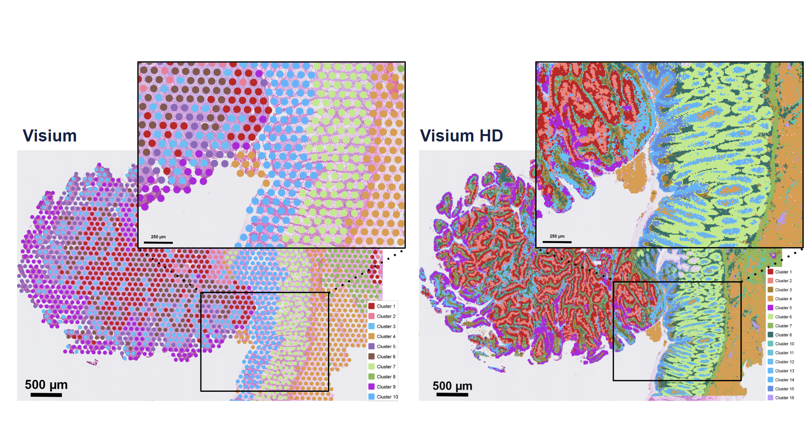
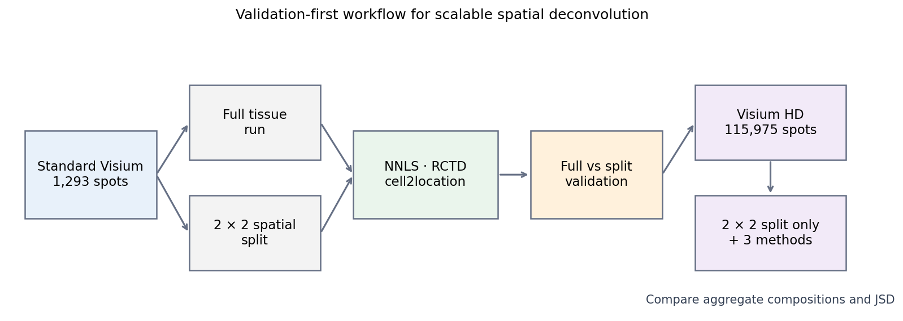
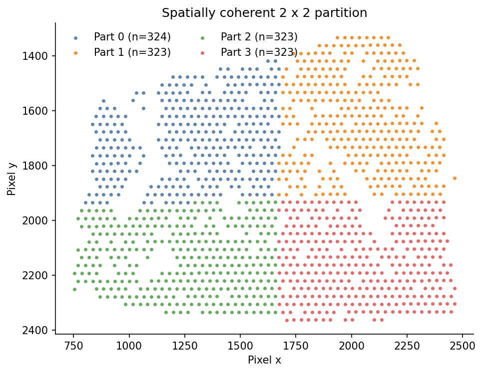
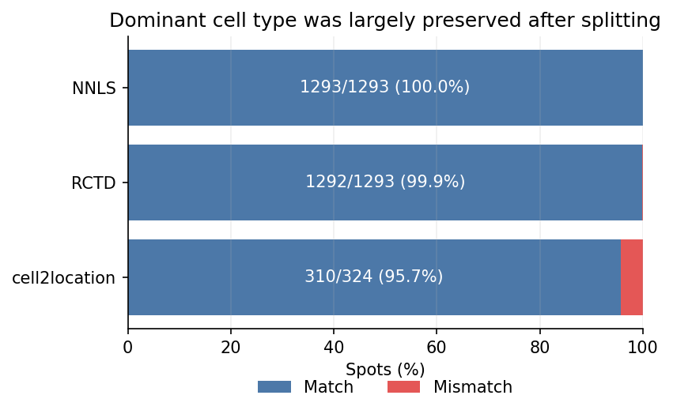
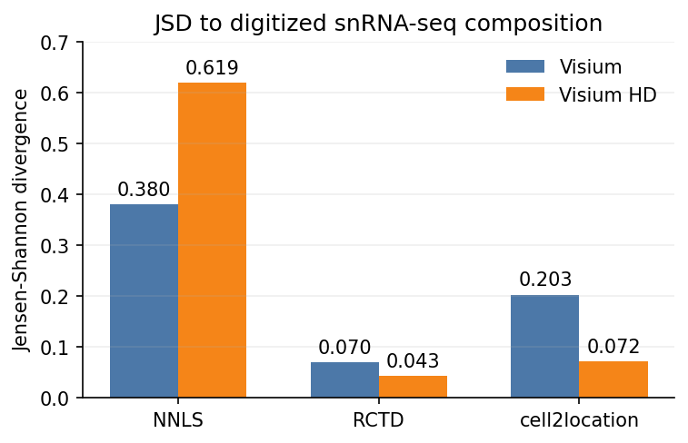
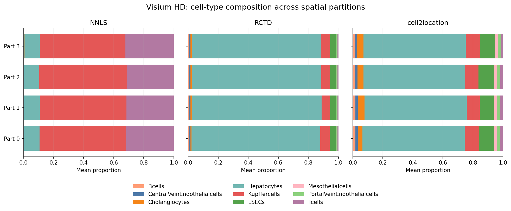

# Scalable spatial deconvolution with an snRNA-seq reference for Visium and Visium HD

This portfolio project asks whether a spatial transcriptomics tissue can be divided into smaller regions before cell-type deconvolution **without materially changing the result**. The strategy was validated on standard Visium and then applied to the much larger Visium HD dataset.



## Objective

Visium HD contained 115,975 spatial bins and was too computationally demanding for the same full-tissue workflow used for standard Visium. I therefore tested a 2 × 2 spatial splitting strategy on standard Visium (1,293 spots), where full and split runs could be compared directly, before transferring the approach to Visium HD.

The recovered group repository contains runs for four standard-Visium liver slides (`JB01`–`JB04`). They served two different analysis scopes: benchmark reproduction and reference-sensitivity summaries used all four slides, whereas the report's 1,293-spot full-versus-split validation used `JB01`. This focused portfolio retains the `JB01` nuclei-reference matrices supporting that main split-validation result rather than presenting the four slides as one pooled split experiment.

There is **no full-tissue Visium HD run** in this project. The three analyzed conditions are:

1. standard Visium, full tissue;
2. standard Visium, four spatial partitions;
3. Visium HD, four spatial partitions.



## Methods

Three methods were selected to cover different modeling assumptions:

- **NNLS** — a simple linear baseline;
- **RCTD** — a count-based probabilistic method;
- **cell2location** — a Bayesian generative method.

All methods were executed through the original [Spotless benchmark](https://github.com/saeyslab/spotless-benchmark) framework. This portfolio retains the PBS/Nextflow submission wrapper I used to launch NNLS, RCTD, and cell2location; it links to the upstream method implementations rather than copying code I did not author.

On the university HPC system, PBS allocated the compute resources, Nextflow orchestrated the method-specific jobs, and Apptainer supplied the containerized software environments. These details are retained because they show how the computationally heavy analysis was executed, but they remain supporting infrastructure rather than the main scientific result.

The compact full-versus-split results retained here use the **`nuclei` / `annot_cd45` nine-cell-type reference** derived from the Liver Cell Atlas single-cell/single-nucleus series [GSE192740](https://www.ncbi.nlm.nih.gov/geo/query/acc.cgi?acc=GSE192740). In the original workflow, the deconvolution methods received the processed object `liver_mouseStSt_nuclei_9celltypes_annot_cd45.rds`. I used this prepared reference as a method input; I did not generate or preprocess the underlying snRNA-seq atlas data. The processed RDS itself was not recovered and is not redistributed here.

The group also ran `noEC`, `inVivo`, and `exVivo` reference conditions as a separate reference-sensitivity exercise; those alternatives are not the basis of this portfolio's main split comparison.

The splitting code assigns every spot to one of four spatially coherent regions, runs deconvolution independently per region, and maps the outputs back to their original locations.



## Where to see the actual implementation

| Project step | Implementation retained here |
|---|---|
| Prepare Visium inputs | [`execution/prepare_inputs/`](execution/prepare_inputs/) |
| Divide the tissue into four spatial parts | [`execution/split/`](execution/split/) |
| Submit NNLS, RCTD, or cell2location through PBS/Nextflow | [`execution/run_methods/`](execution/run_methods/) |
| Merge partition-level outputs | [`execution/merge/`](execution/merge/) |
| Explore standard Visium and visualize proportions | [`exploration/visium/`](exploration/visium/) |
| Inspect Visium HD sparsity and QC | [`exploration/visium_hd/`](exploration/visium_hd/) |
| Reproduce the benchmark across `JB01`–`JB04` | upstream [`3a_evaluate_liver_visium.R`](https://github.com/saeyslab/spotless-benchmark/blob/main/scripts/liver_analysis/3a_evaluate_liver_visium.R) |
| Compare full versus split results and build portfolio figures | [`analysis/`](analysis/) |
| Inspect the original group HPC submission and config changes | [`provenance/group_project/execution/`](provenance/group_project/execution/) |

The `execution/` and `exploration/` folders preserve the practical project workflow. The `analysis/` folder provides a compact, reusable interface around the retained outputs; it does not replace the historical implementation.

## Key results

### 1. Splitting preserved standard-Visium results

| Method | Scope | Dominant cell-type agreement |
|---|---|---:|
| NNLS | all 1,293 spots | 100.0% |
| RCTD | all 1,293 spots | 99.9% |
| cell2location | Part 0, 324 spots | 95.7% |



For the retained numeric outputs, RCTD had a mean absolute error of 0.0137 and correlation of 0.9992; cell2location Part 0 had a mean absolute error of 0.0148 and correlation of 0.9933. Splitting therefore preserved the main biological interpretation, although cell2location showed some local proportion shifts.

### 2. RCTD and cell2location were closer to the snRNA-seq composition

Lower Jensen–Shannon divergence (JSD) indicates closer aggregate agreement with an approximate nine-cell-type composition vector digitized from a Spotless benchmark figure.

| Method | Visium JSD | Visium HD JSD |
|---|---:|---:|
| NNLS | 0.380 | 0.619 |
| RCTD | 0.070 | 0.043 |
| cell2location | 0.203 | 0.072 |



Because the Spotless paper did not publish the numeric proportions, the group project extracted the comparison vector from its bar plot with WebPlotDigitizer. It is therefore an **approximate evaluation target**, not the expression-and-annotation object supplied to NNLS, RCTD, and cell2location, and not spot-level ground truth.

### 3. Method choice mattered on Visium HD

Across the four HD partitions, RCTD and cell2location emphasized hepatocyte and endothelial populations, whereas NNLS assigned much larger proportions to Kupffer and T cells.



Together, the results support spatial splitting as a practical scaling strategy while showing that the selected deconvolution model still strongly affects the inferred HD composition.

## Data availability

| Input needed for a run | Original source | What this repository includes |
|---|---|---|
| **SP:** standard Visium mouse liver | [Guilliams et al. (2022), *Cell*](https://doi.org/10.1016/j.cell.2021.12.018); spatial GEO series [GSE192741](https://www.ncbi.nlm.nih.gov/geo/query/acc.cgi?acc=GSE192741), sample `GSM5764414` | coordinates, split assignments, and small full/split proportion matrices—not raw spatial counts/images |
| **SC/snRNA:** mouse liver method reference | same study; single-cell/single-nucleus GEO series [GSE192740](https://www.ncbi.nlm.nih.gov/geo/query/acc.cgi?acc=GSE192740); project input `liver_mouseStSt_nuclei_9celltypes_annot_cd45.rds` | the processed expression/annotation RDS is **not included**; only the separately digitized composition vector used for JSD evaluation is retained |
| **SP:** Visium HD liver | group project dataset; no public download accession was identified | aggregate summaries and non-reconstructive figures only |

`GSE192741` (spatial) and `GSE192740` (single-cell/single-nucleus) are separate subseries of the umbrella Liver Cell Atlas record [GSE192742](https://www.ncbi.nlm.nih.gov/geo/query/acc.cgi?acc=GSE192742). To rerun NNLS, RCTD, or cell2location, both spatial expression data and a cell-type-annotated reference expression object are required. See [data/ACCESS.md](data/ACCESS.md). Raw counts, images, SpatialData/Zarr objects, trained models, and spot-level HD matrices are intentionally excluded.

See [data/README.md](data/README.md) and [docs/DATA.md](docs/DATA.md) for the exact source lineage and inclusion policy.

### Primary data reference

Guilliams M, Bonnardel J, Haest B, et al. [Spatial proteogenomics reveals distinct and evolutionarily conserved hepatic macrophage niches](https://doi.org/10.1016/j.cell.2021.12.018). *Cell*. 2022;185(2):379–396.e38. PMID: [35021063](https://pubmed.ncbi.nlm.nih.gov/35021063/).

## Project context and contribution

This repository is a focused portfolio fork of Spotless. The original university project was completed by **Sarah Verschuere, Chaeyoung Kim, Hyojun Bae, and Dries Huybens**.

My contributions included benchmarking RCTD and cell2location on standard Visium; co-developing the spatial splitting procedure; running and visualizing RCTD and cell2location on split Visium; running RCTD on Visium HD; and performing Visium HD sparsity and summary analyses.

The original group contribution record is preserved in [CONTRIBUTIONS.md](CONTRIBUTIONS.md), upstream attribution is documented in [NOTICE.md](NOTICE.md), curated-versus-recovered file origins are listed in [docs/FILE_LINEAGE.md](docs/FILE_LINEAGE.md), the recovered desktop repository audit is recorded in [docs/SOURCE_AUDIT.md](docs/SOURCE_AUDIT.md), and the recovery status of every report figure is recorded in [docs/REPORT_FIGURE_AUDIT.md](docs/REPORT_FIGURE_AUDIT.md).

## Repository map

```text
exploration/              original Visium and HD QC/exploration notebooks
execution/                prepare inputs → split → submit methods → merge partitions
analysis/                 reproducible comparisons, QC summaries, and figure generation
data/                     compact public-Visium inputs and digitized composition reference
results/                  reported values, derived summaries, and portfolio figures
provenance/               historical group plotting scripts and source notes
docs/                     data policy and original upstream documentation
```

To regenerate the compact figures:

```bash
python -m pip install -r requirements.txt
MPLBACKEND=Agg python analysis/make_figures.py
```

## Limitations

- Full-versus-split validation is available only for standard Visium, not Visium HD.
- The retained cell2location full-versus-split numeric check covers Part 0.
- The full-tissue NNLS matrix was not recovered locally; its 100% agreement is retained as a paper-reported result.
- The processed snRNA-seq reference RDS is unavailable, so the deconvolution runs cannot be recreated end-to-end from this repository alone. The retained digitized composition vector supports only the aggregate JSD comparison.
